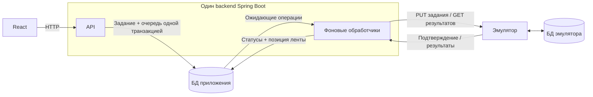
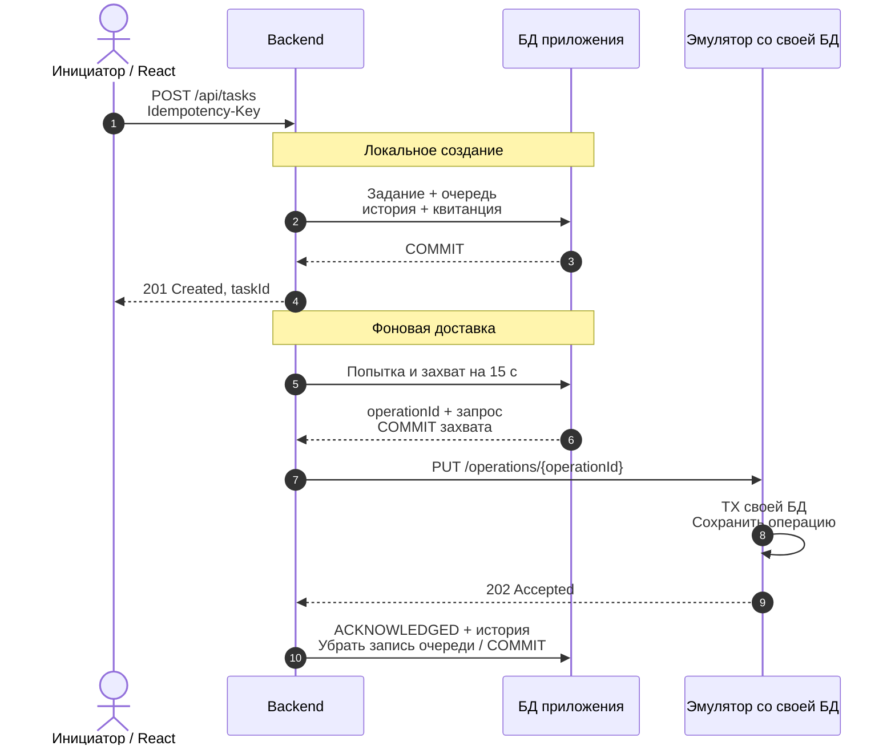
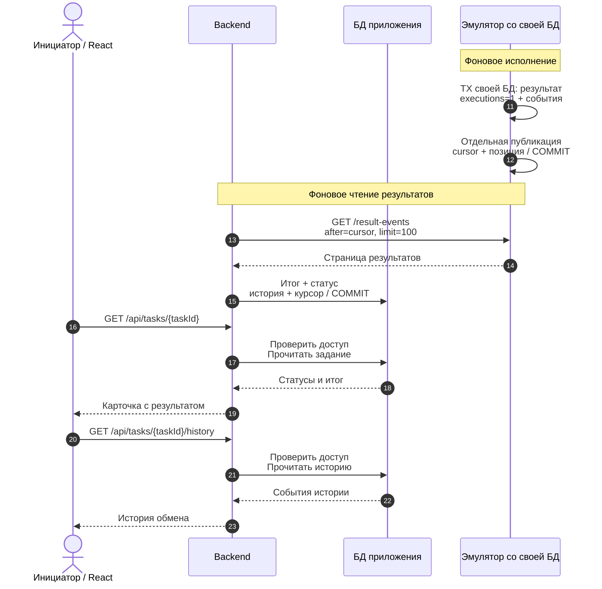
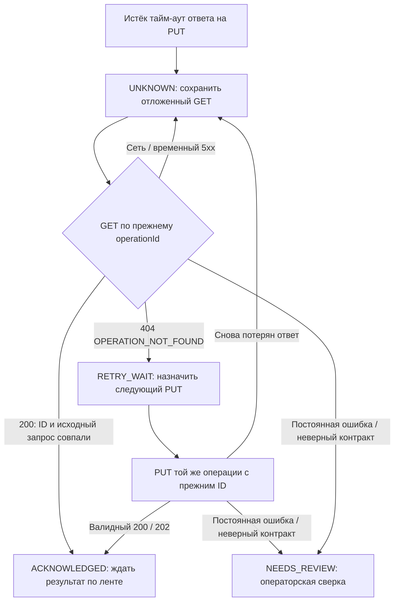

# Архитектура

Внутреннее приложение — один Spring Boot backend с модулями по предметным
областям. Эмулятор запускается отдельно, чтобы его можно было отключить и
независимо проверить факт исполнения. Оба процесса используют один сервер
PostgreSQL с отдельной БД и ролью для каждого. Экраны находятся в `frontend/`,
Java-код — в `backend/` и `emulator/`. Совместный запуск задаёт корневой `compose.yml`.

Темой владеет корневой React-компонент через небольшой hook в app/theme.tsx.
Палитры Base находятся в ui/design-tokens.css; переключение меняет атрибут
корневого элемента, не пересоздавая экраны и формы. localStorage хранит
только предпочтение оформления. Используются режимы Base dark / light / gray;
зависимость от @pdlc/ui и платформенный механизм cookies не нужны. Происхождение и адаптация перечислены в [описании UI](../frontend/src/ui/README.md).

## Схема компонентов

API и фоновые обработчики находятся в одном Java-процессе. Эмулятор — другой
Java-процесс со своей БД и ролью. Сейчас обе БД работают на одном PostgreSQL.
Все стрелки между backend и эмулятором обозначают HTTP: эмулятор отвечает на
наши запросы, а backend сам читает ленту результатов.

Очередь delivery_queue — transactional outbox приложения: создание задания
и обязанность его отправить фиксируются одним коммитом. В эмуляторе результат
и result_events также записываются одной транзакцией; публикация присваивает
событиям позиции для чтения.

## Типичный поток задания

Пример: вошедший инициатор создаёт заявку REQ-000123 на 25 единиц.
Это допустимое количество, поэтому эмулятор завершит её успешно.

«Забрать из очереди» означает выбрать сохранённую операцию, временно закрепить
её за обработчиком и отправить HTTP-запрос. Транзакция захвата заканчивается
до сетевого вызова; состояние после ответа сохраняется другой транзакцией.

Для читаемости эмулятор и его БД объединены в одного участника последовательности.
Подписи TX обозначают транзакции именно его БД; на схеме компонентов они разделены.

### 1. Локальное сохранение и доставка

### 2. Исполнение и получение итога

Продолжение той же операции с прежним operationId. Позиция ленты принадлежит
обработчику результатов и сохраняется после обработки страницы.

### Что видит пользователь

| Момент | Доставка | Бизнес-статус |
| --- | --- | --- |
| Локальное создание завершилось, получен taskId | QUEUED | PENDING |
| Эмулятор подтвердил приём | ACKNOWLEDGED | PENDING |
| Применён промежуточный результат версии 1 | ACKNOWLEDGED | RUNNING |
| Применён итог версии 2 | ACKNOWLEDGED | SUCCEEDED или REJECTED |

201 означает сохранение в нашем приложении; 202 от эмулятора — приём внешней
операции. Итог исполнения приходит отдельно. Для количества больше 100
эмулятор возвращает бизнес-итог REJECTED с причиной, а не ошибку доставки.

На схеме показан один допустимый порядок. Фоновые задачи работают независимо:
результат может прийти раньше HTTP-подтверждения, а RUNNING и итог могут
примениться за одно чтение страницы. Проверка ID, исходного запроса, версии
и захвата предотвращает откат состояния поздним ответом.

Карточка и история опрашиваются независимо по одному правилу: активное
исполнение/доставка каждые 3 с; NEEDS_REVIEW, STOPPED и завершённые — каждые
10 с. Поэтому итог и действия другого оператора появляются без повторного
открытия страницы, в том числе после завершения задания.

### Какие идентификаторы проходят через поток

| Значение | Назначение |
| --- | --- |
| Idempotency-Key | Отличает команду пользователя. Повтор создания с тем же пользователем, типом команды, ключом и телом возвращает прежний taskId. |
| taskId | Идентификатор задания в нашем приложении и его URL. |
| operationId | Неизменный ID внешней бизнес-операции. Один и тот же при всех PUT, уточняющих GET, результатах и сверках. |
| cursor | Позиция события в ленте. Последняя обработанная позиция сохраняется вместе с применёнными изменениями. |
| version | Версия результата операции: 1 для RUNNING, 2 для SUCCEEDED/REJECTED. Поздняя версия 1 не откатывает итог. |

Позиция события и версия результата решают разные задачи: повтор результата
может иметь другую позицию ленты. Проверка содержимого и версии обеспечивает
отсутствие второго бизнес-эффекта.

### Если ответ потерян

Ветка относится к операции без подтверждения и без уже применённого результата.
Поздний тайм-аут не откатывает подтверждённую доставку или готовый итог.

Эмулятор мог уже исполнить операцию, поэтому после неопределённого исхода
backend сначала уточняет состояние GET по прежнему operationId.
Валидный GET подтверждает доставку; обычный обработчик доставки не применяет
из него бизнес-результат. Итог поступает по ленте либо применяется отдельным
разрешённым решением оператора после сверки.

Если PUT заведомо не установил соединение, следующий шаг — повтор PUT.
Паузы, счётчик и время следующей попытки сохраняются в БД по
[правилам повторов](analysis.md#доставка-и-повтор).

В демонстрационном режиме DROP_RESPONSE_AFTER_EXECUTION первый ответ
задерживается на 5 с, превышая тайм-аут backend в 2 с. Исполнение уже сохранено.
События удерживаются до снятия режима, чтобы можно было воспроизвести сверку;
этот управляемый режим отличается от обычной работы эмулятора.

### Где появляется оператор

При некорректном протоколе или расхождении сохраняется проблема.
Оператор открывает её, берёт разбор на себя и запускает сверку.
Backend читает фактическое состояние эмулятора и сохраняет оба снимка,
автора, время и результат сравнения.

Доступные дальнейшие действия определяет сервер: повтор допустимой отправки
с прежним ID, применение подходящего внешнего итога либо фиксация расхождения.
Решение требует причины и актуальной версии; бизнес-состояние не перезаписывается
одним только просмотром сверки. Все действия остаются в истории.
Условия действий заданы в [аналитике](analysis.md#сверка-и-действия-оператора).

Реализация потока:
[создание](../backend/src/main/java/com/azhukov/integration/service/TaskService.java),
[фоновые HTTP-вызовы](../backend/src/main/java/com/azhukov/integration/service/ExchangeCoordinator.java),
[планировщик](../backend/src/main/java/com/azhukov/integration/scheduler/ExchangeScheduler.java),
[захват и применение результатов](../backend/src/main/java/com/azhukov/integration/service/ExchangeService.java),
[исполнение и публикация эмулятора](../emulator/src/main/java/com/azhukov/emulator/service/OperationService.java).

## Границы кода

Gradle Wrapper и settings.gradle находятся в нейтральном корне. Соседние
backend/ и emulator/ собираются адресными задачами; бизнес-исходников в корне нет.
Общая настройка OpenAPI находится в build.gradle, generated outputs принадлежат
build-каталогу каждого приложения. Контрактный JAR и buildSrc не нужны.
Dockerfile имеет независимые backend/emulator build stages; чужие Java-исходники
не входят в целевой stage. Общий PostgreSQL init — deploy/postgres/init.sh;
Flyway-миграции остаются внутри каждого приложения.

Основное приложение — один контекст интеграции; эмулятор — отдельный процесс
со своей моделью и БД. Domain не зависит от Spring, JDBC, Jackson и HTTP DTO.
Направление вызовов: controller → service → repository/client;
JDBC и HTTP реализуют эти контракты. Предметные правила остаются в domain.
MapStruct преобразует HTTP DTO; security преобразует пользователя в Actor.

~~~text
com.azhukov.integration
  controller/       тонкие generated API
  service/          сценарии, права, транзакции и координация
    idempotency/    квитанции команд и координация
  repository/       контракты хранения
    jdbc/           SQL и row mapping
  domain/           task, exchange, review: состояние и правила
  dto/              внутренние команды, результаты и страницы
  mapper/           MapStruct HTTP-проекции
  json/             общий канонический fingerprint квитанций и диагностики
  client/http/      внешний HTTP и проверка протокола
  security/         Spring Security и сессия
  scheduler/        тонкие планировщики
  config/           Boot, JSON mixins и MapStructConfig
  exception/        отображение ошибок в HTTP

com.azhukov.emulator
  controller/, service/, repository/jdbc/, domain/, mapper/
  config/, scheduler/, exception/
~~~

Task владеет неизменяемым исходным запросом и двумя независимыми ревизиями
названия и обмена. Проблема/сверка — отдельные модели: у общей проблемы ленты
может отсутствовать taskId. История и очередь сохраняются в той же транзакции,
но не загружаются неограниченными коллекциями сущности. Value objects вводятся
для действительных инвариантов; чтение возвращает небольшие внутренние проекции.

| Область | Что ей принадлежит |
| --- | --- |
| `frontend/src/app` | Оболочка, маршруты, сессия и единственное состояние цветовой темы. |
| `frontend/src/features/{tasks,operations}` | Самостоятельные страницы task-list/create/details, issue-list/details и reconciliation-details. Малые формы рядом с владельцами; кнопка сверки и отображение снимка общие только для реальных потребителей. На узком экране список показан карточками. |
| `frontend/src/ui` | Компоненты, которые используются несколькими экранами. Поля, кнопки, карточки, заголовки, таблица, история и состояния скопированы из Base с атрибуцией. Правила и палитры общие, специфичная разметка остаётся в экранах. |
| `backend/src/main/java/com/azhukov/integration/security` | Вход, сессия и роли Spring Security. |
| backend domain | task/exchange/review: состояние, инварианты и переходы без Spring/JDBC/HTTP DTO. |
| backend service / repository / client | Сценарии, права и транзакции используют явные контракты хранения/обмена. |
| backend repository/jdbc / client/http / scheduler | SQL, внешний протокол и тонкие планировщики. |
| backend controller / mapper / exception | Generated API, MapStruct-преобразование DTO/actor и HTTP-ошибки. |
| `emulator/` | Независимое Gradle-приложение. Приём, исполнение, хранение результата и управление сбоями. |
| `contracts/` | Версионируемые контракты внутреннего API и внешнего обмена. |
| `tests/` | Проверки запущенного сервиса и нагрузка. |

Таблица описывает текущие границы исходников; проверенный кандидат и публичная
версия отдельно указаны в [текущей стадии](current-stage.md).
Spring MVC принимает запросы, Spring Security
проверяет сессию и роль. Прикладные операции проверяют права на конкретную
запись, применяют бизнес-правила и определяют границы транзакций.
Репозитории выполняют SQL через Spring JDBC.

## Правила разработки

| Компонент | Ответственность |
| --- | --- |
| TaskRepository / JdbcTaskRepository | Задания, страницы и история. |
| ExchangeRepository / JdbcExchangeRepository | Состояние обмена, очередь, попытки и курсор. TaskRowMapper читает общие проекции; SQL не дублируется. |
| TaskService | Создание/чтение/переименование, права и атомарное задание/outbox/история/квитанция. |
| ExchangeService | Захват/фиксация попытки/применение страницы; чистые переходы в domain, SQL в репозитории. |
| ReviewContext / IssueLifecycleService / ReviewService | Domain-политика действий, транзакции операторского разбора и история через ReviewRepository/JdbcReviewRepository. |
| IdempotencyService / CommandReceiptRepository | Сервис координирует lock/read/callback/save и JSON. JdbcCommandReceiptRepository только блокирует, читает и пишет; транзакция обязательна от вызывающего сценария. |
| HttpExternalExchangeClient / ExchangeProtocol | Внешний HTTP-адаптер, строгая проверка протокола и преобразование во внутреннюю модель. |
| ReconciliationService / ExchangeCoordinator / ExchangeScheduler | HTTP между короткими транзакциями, четыре отправителя и ограниченный executor. Сверка использует два существующих bean: prepare/save в ReviewService, сеть в ReconciliationService. |
| OperationService / OperationRepository / JdbcOperationRepository эмулятора | Независимое исполнение и публикация событий, своя БД; HTTP-проекции в OperationApiMapper. |
| TaskApiMapper / ReviewApiMapper / OperationApiMapper | Реальные MapStruct Spring beans; поля и enum/null проверяются через generated impl, бизнес-решений нет. |
| RuleViolation / ApiExceptionHandler | Предметная ошибка и единый действующий HTTP-формат. |

- Контроллер преобразует HTTP DTO и пользователя в прикладную команду.
  Domain и service используют внутренние типы; generated DTO остаются
  на HTTP-границах. React использует сгенерированный Fetch-клиент.
- У данных и правил один владелец. TaskService создаёт задание, outbox,
  историю и квитанцию одной транзакцией. ExchangeService захватывает и завершает
  попытки, применяет результаты; ExchangeCoordinator выполняет HTTP между
  транзакциями. SQL находится в repository/jdbc.
- Обычный сценарий реализуем конкретными классами и методами. Lombok убирает только простой DI/log; валидирующие конструкторы сохраняются.
  MapStructConfig запрещает незамаппленные целевые поля; generated находится
  только в build, processors не включаются в runtime. Отдельный
  интерфейс нужен для действующего контракта или заменяемой внешней границы.
  Выделяйте общий код, когда у него есть реальные потребители и одинаковое
  правило. Каталог, слой или зависимость появляются вместе с задачей, которой
  они нужны.
- Очередь в PostgreSQL обеспечивает надёжную отправку после коммита и
  перезапуска (transactional outbox). Уникальный ключ делает команды
  идемпотентными. Версия названия защищает от потерянного обновления
  (оптимистическая блокировка). Внешние операции и события сохраняют свои ID
  и версии, по которым сервер решает, применим ли результат.
- Проверяйте правило на ближайшей подходящей границе: чистое правило — unit,
  ограничения и транзакции — PostgreSQL, права — HTTP API, пользовательский
  сценарий — запущенный сервис. Подробности в [инструкции по тестам](../tests/README.md).

Сохраняем Spring JDBC: операции интеграции уже требуют явных захватов,
очереди и управления курсором, а текущие SQL можно инкапсулировать за портами.
JPA — допустимая альтернатива с native SQL/locking, но её превосходство здесь
не измерено; смена ORM не является условием DDD и не решает сама по себе нагрузку.
Интерфейсы описывают реальные границы I/O; generic CRUD, BaseEntity,
UnitOfWork, command bus, event sourcing и новая система CQRS не нужны.
Не добавляем MapStruct только ради названия технологии: ручной небольшой
маппинг допустим, генератор оправдан повторяющимся объёмом преобразований.

Слой service использует обычные Spring beans, constructor injection
и транзакционные методы, вызываемые через proxy. Внешний HTTP выполняется
между такими методами; self-invocation не создаёт новую транзакционную границу.
Это штатное поведение [Spring Transaction Management](https://docs.spring.io/spring-framework/reference/data-access/transaction/declarative/annotations.html).
Существующие virtual threads, отдельные фоновые задачи, HTTP deadline,
Hikari и ограничения контейнеров сохраняются и проверяются, а не перенастраиваются
наугад. Новый web framework и реактивный стек для этого не нужны.

## Хранение

| Владелец | Данные и ограничения |
| --- | --- |
| Внутреннее приложение, реестр | Пользователи и задания. У задания есть владелец, уникальный ID внешней операции, неизменяемый запрос, локальное название и его версия. Индексы покрывают доступ по владельцу и стабильную сортировку. |
| Внутреннее приложение, обмен | Одна запись очереди на операцию со следующим шагом, сроком и счётчиком попыток. Журнал попыток и позиция чтения ленты. Индекс очереди покрывает срок следующего вызова. |
| Внутреннее приложение, команды и аудит | Результаты успешных команд с уникальным ключом в области пользователя и вида действия. Отпечаток команды включает цель и полезную нагрузку. События истории, проблемы и снимки сверок связаны с заданием. |
| Эмулятор | Операции с уникальным ID, события результата с позицией публикации и настройки сбоев. Режим заранее привязывается к номеру заявки, затем к ID операции. Итог, счётчик исполнения и `completedAt` фиксируются одной транзакцией. |

У каждого процесса свой пользователь PostgreSQL и собственная БД. Миграции
Flyway начинаются с `V1__...` для каждой БД. Схема применяется миграциями,
демоданные загружаются отдельно. Очередь хранится в PostgreSQL, поскольку
запись задания и постановка в очередь должны фиксироваться одной транзакцией.

### Базовые ограничения задания

| Таблица | Поля и ограничения |
| --- | --- |
| `users` | `id UUID PRIMARY KEY`, `username VARCHAR(64) UNIQUE NOT NULL`, `password_hash TEXT NOT NULL`, `role NOT NULL` со значениями `INITIATOR` и `OPERATOR`. Логин хранится строчными латинскими буквами, допустимы цифры, точка, дефис и подчёркивание. Вход приводит логин к этому виду. |
| `tasks` | `id UUID PRIMARY KEY`, `owner_id UUID NOT NULL REFERENCES users(id)`, `operation_id UUID UNIQUE NOT NULL`, `title VARCHAR(160) NOT NULL`, `title_revision BIGINT NOT NULL DEFAULT 1`, `request_reference VARCHAR(10) NOT NULL`, `request_quantity INTEGER NOT NULL`, `delivery_status NOT NULL DEFAULT 'QUEUED'`, `business_status NOT NULL DEFAULT 'PENDING'`, `created_at TIMESTAMPTZ NOT NULL`. Допустимые значения и границы полей определяет OpenAPI. БД дублирует базовые ограничения длины, формата, количества и статусов. |

ID задания и операции создаёт приложение, ID владельца берётся из сессии.
Владелец, номер заявки и количество не входят в команды изменения. Приложение
разрешает создать задание только инициатору. Поля учётки, кроме публичного
логина, роли и ID, не выдаются через API.

Реестр сортируется по `created_at DESC, id DESC`. Для первого этапа достаточно
индексов по `(owner_id, created_at DESC, id DESC)` и
`(created_at DESC, id DESC)`. Индекс по владельцу/статусу добавлен миграцией V6 после измерений NF08. Записи для проверки доступа создаются отдельно
от миграции.

### Миграции хранения

- SI-02 добавляет квитанции команд, очередь и неизменяемую историю. Уникальные
  ключи — `(actor_id, command_type, idempotency_key)` для квитанции и
  `operation_id` для записи отправки. В квитанции лежат отпечаток значимых полей,
  HTTP-статус и тело исходного успешного ответа.
- SI-03 добавляет в БД приложения попытки доставки, позицию ленты, принятый
  результат и записи проблем с диагностикой первого ошибочного события.
  В БД уникален ключ из области операции и отпечатка причины с содержимым.
  Для событий без известного ID областью служит общая лента.
  Валидный JSON нормализуется перед хешированием,
  для неразбираемого тела используется хеш байтов. Курсор и время получения
  исключаются из отпечатка. Внешняя БД хранит операции, события и режимы отказа.
  Версия обмена задания растёт при изменении
  доставки или результата и независима от `title_revision`. У общей
  проблемы ленты связь с заданием может отсутствовать.
- SI-04 добавляет сверки, ответственного за проблему и решения. Запись проблемы
  хранит ID ответственного оператора и собственную версию для защиты команд.
  Сверка хранит автора, оба снимка и версию обмена на момент сравнения. У решения
  есть ссылка на сверку и автора. Событие передачи хранит прежнего и нового
  ответственных по [правилам аналитики](analysis.md#задание-и-роли).

## Совместимость и атомарность

- Создание задания, outbox, история и успешная квитанция — один commit.
  Результат страницы и курсор — один commit. Durable-работа не переносится
  в обработчик Spring-события после commit.
- Старые квитанции и сверки читаются новым кодом. Отпечаток сохраняет
  нормализованную форму прежнего входа, включая null/отсутствующее поле,
  числа и имена полей. Новый Command с actor/key целиком не хешируется.
  Проверка доступа предшествует возврату сохранённого ответа.
- title_revision не объединяется с exchange_version. Lease, право завершить
  попытку, дедупликация, конфликт одной версии и поздний результат сохраняют смысл.
- Ошибка применения откатывает всю страницу. Несколько событий одной операции
  внутри страницы применяются по курсору с учётом уже обновлённого состояния.
  Порядок получения блокировок нескольких заданий задаётся отдельно и одинаково
  у конкурирующих операций; порядок IN-списка сам по себе его не гарантирует.
- У эмулятора публикация курсоров следует порядку commit. Счётчик и события
  меняются одной транзакцией; sequence с независимо коммитящими издателями
  не заменяет этот механизм. Режимы сбоев сохраняют исходный смысл.

Зависимости слоёв проверяются тестами классов, например ArchUnit как test-only
зависимостью с проверенной поддержкой Java 25; самодельный regex-анализатор
исходников не нужен. Правила: domain без фреймворков/HTTP DTO, service без
controller/JDBC/HTTP-адаптеров, controller без SQL, отсутствие циклов. Ограничения проверяют
реальные импорты, не только имена пакетов.

## Задание и доставка

Доставка и исполнение хранятся отдельно. Переходы, правила времени и
действия оператора определяет [аналитика](analysis.md).

При создании одна транзакция записывает задание, запись доставки, квитанцию
команды и событие истории. Клиент получает ответ после коммита PostgreSQL.
HTTP к исполнителю вызывает фоновый обработчик.

Запись доставки хранит следующий шаг, время попытки и временное право обработки. Обработчик захватывает запись через `FOR UPDATE SKIP LOCKED`, фиксирует попытку и освобождает транзакцию перед HTTP. Каждый захват относится к одному вызову и действует 15 с, что оставляет запас на сетевой тайм-аут и запись результата. Ответ применяется в новой транзакции при совпадении идентификатора захвата. Просроченный захват возвращается в обработку по правилам восстановления из аналитики.
Автоматическое расписание и ручной повтор меняют эту же запись.
У ручной команды сохраняется обычная квитанция идемпотентности. Её исход
отражается в состоянии задания и истории.

## Восстановление эмулятора

PUT атомарно создаёт операцию с уникальным ID и неизменным запросом.
При конфликте ID сравнивается тело команды. GET возвращает сохранённый
запрос вместе с состоянием. Подтверждения и события также включают запрос
из БД операции. Потребитель проверяет ID и запрос перед применением снимка,
включая события, пришедшие раньше ответа на PUT.

Обработчик выбирает операции с `executions = 0` под блокировкой строки.
Вымышленная проверка выполняется в одной транзакции с фиксацией итога,
`executions = 1`, `completedAt` и строк событий. После отката или
перезапуска операция с нулевым счётчиком снова доступна обработчику.
Два обработчика одного ID сериализуются блокировкой.

Строка события сохраняется вместе с итогом, а курсор получает при
публикации. События с пустым курсором после перезапуска снова доступны
публикатору. Уникальность `(operation_id, version, copy_number)`
защищает от повторной записи. У обычного события `copy_number = 0`,
у второй копии режима дубликата — 1. Публикация назначает курсор
в существующей таблице событий. Режимы задержки определяют, когда
строку можно опубликовать.

## HTTP и применение результата

Схемы, статусы ответов и поля задают [OpenAPI внутреннего API](../contracts/internal-api.openapi.yaml)
и [OpenAPI обмена](../contracts/external-exchange.openapi.yaml). Frontend
использует первый контракт. Второй связывает backend с эмулятором внутри
изолированной локальной сети.

Gradle вызывает OpenAPI Generator перед компиляцией Java. Для внутреннего
API получаются `SessionApi`, `TasksApi`, `OperationsApi`,
`AuthenticationApi` и DTO. Контроллеры используют интерфейсы сессии,
заданий и операторских действий. Вход и выход обслуживают фильтры
Spring Security. Контроллеры эмулятора используют `ExchangeApi` и
`TestFaultsApi`, причём служебные маршруты включаются только тестовым
профилем. Сгенерированные интерфейсы содержат аннотации Spring MVC.

Frontend запускает Orval перед проверкой типов и сборкой. Клиент использует
относительные URL, поддерживает обязательные заголовки CSRF и идемпотентности
из схемы и возвращает HTTP-статус вместе с типизированным телом. Vite
проксирует `/api` на backend при локальной разработке.

Сгенерированные артефакты лежат в каталогах сборки и не входят в исходники.
Ревизии и позиции ленты имеют формат `int64` с верхней границей безопасного
целого JavaScript. Схема различает отсутствующий `rejectionCode` и
обязательное поле `result`, которое может содержать `null`. Прикладной код
до записи в БД проверяет связь версии и статуса результата, а также тип
события, автора и обязательные поля назначения. Проверки на реальном API
входят в TC-04 и TC-08.

Приложение сохраняет позицию ленты в той же транзакции, что и применение
события или регистрация проблемы. Если другой обработчик уже продвинул
позицию, страница перечитывается с актуального курсора. После блокировки
курсора состояния известных операций загружаются одним SELECT ORDER BY id
FOR UPDATE (до 100 операций). Локальная map живёт только в транзакции страницы
и обновляется после каждого APPLY; последующий дубликат видит новое состояние.
Эмулятор присваивает позиции при публикации под блокировкой строки счётчика, чтобы порядок позиций
совпадал с порядком коммитов. Правила повторов, проверки входящих снимков
и действий оператора заданы в [аналитике](analysis.md#доставка-и-повтор).

Исполнение и публикация в эмуляторе выполняются двумя независимыми заданиями
штатного планировщика. Ожидание блокировки счётчика публикации не останавливает
исполнение уже принятых операций. Запись результата и событий остаётся атомарной;
позиция присваивается отдельной транзакцией после их сохранения.

Служебное управление эмулятором доступно только в тестовом профиле и закрытой
сети. Привязка к номеру заявки позволяет включить отказ до того, как внутреннее
приложение присвоит ID операции. Поведение режимов задано в
[аналитике](analysis.md#демонстрация).
При потере первого ответа состояние задержки сохраняется в БД эмулятора.
Удержанный итог получает позицию только при публикации после снятия режима.
Лента может продвигать курсор по другим операциям до этого момента.

## Доступ, история и проверки

Инициатор читает только свои задания и их историю. Оператор видит обмен и проблемы, выполняет сверку и разрешённый повтор. Сервер определяет пользователя по сессии Spring Security. Доступ проверяется в прикладной операции и в условиях запроса к БД. Для изменений используются CSRF-защита, проверка ожидаемой версии и ключи идемпотентности. Повторы и сверка имеют отдельные команды API с собственными правами.

История добавляется в транзакции с изменением и хранит автора или имя фонового процесса, время, действие и идентификаторы задания, попытки и результата. В журнал диагностики попадают эти идентификаторы, категория ошибки и длительность. В API истории предусмотрено только чтение.

Проверки схемы и транзакций выполняются на PostgreSQL. Условия измерения и
операции API описаны в [профиле NF08](../tests/load/README.md).
Порядок этапов ведётся в [роадмапе](roadmap.md), зависимости задач — в
[декомпозиции](decomposition.md).

Точные версии сборки закреплены в [корневой Gradle-сборке](../build.gradle),
[Gradle Wrapper](../gradle/wrapper/gradle-wrapper.properties) и
[package.json](../frontend/package.json). Версии библиотек Spring и
управляемых зависимостей определяет BOM Spring Boot. Для базы выбран
PostgreSQL 18.6. Образ `postgres:18.6-alpine` закреплён в
[Compose](../compose.yml). Порты и запуск описаны в [README](../README.md#локальный-запуск).

Получение пользователя для входа различает ошибку учётных данных (401)
и внутреннюю недоступность сервиса (503 SERVICE_UNAVAILABLE). Внутренняя причина
не попадает в ответ; API и frontend используют один контракт OpenAPI.

Внутренний servlet ERROR-dispatch разрешён штатным правилом Spring Security,
чтобы 404/405/500 не превращались в 403 при обработке ошибки контейнером.
Прямой HTTP-запрос к /error остаётся закрыт. Это проверяет HttpErrorRoutingTest
через настоящий Tomcat, включая транзакционный откат и соседние 401/403.

## Фильтры и страницы

URL — единственный источник применённых фильтров, номера и размера страницы.
Для реестра, истории и разборов API принимает `size` от 1 до 100, по умолчанию 20.
Размер вычисляется по доступной области, числу колонок и измеренной высоте
элементов. Resize обновляет `size` и выбирает страницу, содержащую прежнюю
первую запись. Сохраняется наибольшая измеренная высота при текущей ширине,
чтобы короткая последняя страница не вызывала колебаний размера. Навигация
находится отдельной строкой внизу области; слишком высокий одиночный элемент
прокручивается внутри списка. Бизнес-правила и права от геометрии UI не зависят.
Выбор результата и изменение даты сразу обновляют запрос без кнопки «Применить»,
сбрасывают страницу и сохраняют фокус; переход по страницам сохраняет фильтры.
Неверный UTC-период объясняется до запроса. Устаревшее чтение отменяется через
AbortSignal сгенерированного клиента. Общее число страниц и записей учитывает
права и фильтры. COUNT и выборка выполняются в одной read-only транзакции
REPEATABLE READ с общими предикатами. UI-09 проверяет поведение на двух ширинах.

## Чтение, кэш и повтор команд

PostgreSQL — источник бизнес-состояния. Кэш не определяет права, статус задания
или факт исполнения. Владелец клиентского кэша — один QueryClient в
frontend/src/app/api.ts. Ниже описана реализация, а не гарантия любой нагрузки.

| Данные | Область и свежесть | Обновление и удаление |
| --- | --- | --- |
| Реестр, карточка, история и проблемы | Память вкладки, staleTime 3 с. Ключи различают ресурс, ID, страницу, её размер и применённые фильтры там, где они есть. | Мутации инвалидируют связанные ключи; устаревшие запросы перечитываются при монтировании, возврате фокуса, восстановлении связи или вручную. |
| Карточка задания и история | Один taskRefreshInterval: активные 3 с, NEEDS_REVIEW/STOPPED/SUCCEEDED/REJECTED 10 с. | Независимые чтения без инвалидации из queryFn; история продолжает видеть новые operator-события при неизменном businessStatus. Фоновая вкладка не опрашивается по умолчанию React Query. |
| Сохранённая сверка | Ключ задания и ID сверки, staleTime Infinity: снимок неизменяем. | Новая сверка имеет другой ID; выход и смена пользователя очищают также эти снимки. |
| Сессия | Отдельный ключ, staleTime 0. | readSession сравнивает userId и роль; до публикации другой идентичности отменяет запросы и очищает пользовательские запросы/мутации. Оболочка сбрасывает локальное состояние. Выход сохраняет подписку App на сессию. |
| HTTP API | Spring Security запрещает хранение ответа через Cache-Control: no-store. | Права проверяются сервером при каждом обращении, в том числе к неизменяемой сверке. |
| Статика frontend | Файлы /assets/ с хешем в имени: max-age 1 год; HTML: no-cache через expires -1. | Новый build меняет URL ресурса; HTML перепроверяется. JS/CSS получают .gz при build; gzip_static/Vary включены только для /assets/. Открытая вкладка получает новый код после перезагрузки. |

staleTime определяет свежесть, а не срок удаления или период обновления всех
экранов. Неактивный кэш удаляет React Query по штатному gcTime (5 минут в браузере).
Постоянное сохранение бизнес-данных в localStorage, Service Worker и общий
HTTP-кэш не подключены. localStorage хранит только тему.
Штатное поведение описано в [настройках React Query](https://tanstack.com/query/latest/docs/framework/react/guides/important-defaults).
Чтения одного ключа объединяет React Query; новый слой дедупликации не нужен.
UI-10 проверяет инвалидацию после создания с потерянным ответом, UI-11 —
смену аккаунта вне SPA и повторный вход того же владельца.
Очистка предотвращает показ старых данных; сервер всегда проверяет доступ.

Redis, Caffeine и серверный кэш пользовательских списков сейчас не используются.
NF08 пройден без них. Перед добавлением нужно измерить конкретный дорогой
запрос, план SQL и долю повторных чтений. Для выбранных данных задать владельца,
ключ с областью доступа, предел памяти, TTL, инвалидацию после коммита и поведение
при недоступности кэша. Проверить права, холодный старт и конкурентный промах.
Пустой успех вместо ошибки и подмена БД устаревшим снимком недопустимы.
Точные COUNT на 5 000 записей не доказывают ту же скорость на миллионах.

Идентичность команды — actor + тип команды + Idempotency-Key.
PostgreSQL сохраняет результат и отпечаток входа атомарно с операцией,
transaction advisory lock сериализует одновременные повторы. Другое тело с тем же
ключом даёт 409. Квитанции команд — долговечные данные, не расходный кэш;
их нельзя удалять при очистке QueryClient или по TTL кэша.
Срок удаления квитанций не задан, автоматической очистки нет.
Форма сохраняет ключ после потерянного ответа и очищает после подтверждённого
успеха. Новый ключ означает отдельную операцию; одинаковое содержимое заявки
само по себе не уникально. Автоповторы клиентских мутаций отключены.
HTTP выполняется вне транзакции; доставка повторяется по сохранённому ID операции.
Сверка проверяет доступ и квитанцию до внешнего GET. Повтор возвращает прежний
снимок без сети; конфликт входа даёт 409 также до сети. Первая команда повторно
проверяет квитанцию под advisory lock при сохранении. Первые одновременные GET
могут дублироваться, но сохраняется одна сверка/история; отдельного single-flight нет.

## Потоки и ограничение параллелизма

В исходниках Java 25 и виртуальные HTTP-потоки backend/эмулятора включены
по умолчанию. Оба процесса явно регистрируют ThreadPoolTaskScheduler с двумя
потоками через builder. Hikari ограничен 8/4 соединениями, ожиданием 2 с и validation-timeout 1 с.
Проверка живости соединения короче бюджета получения из пула.
TC-17, NF08 и TC-18 проверены на опубликованном кандидате;
численные результаты и пройденная регрессия HTTP deadline — в [текущей стадии](current-stage.md).
Исходящий HTTP-клиент общий на процесс: connect timeout 1 с и общий deadline 2 с
на завершение sendAsync с BodyHandlers.ofString, включая тело. При тайм-ауте
или прерывании вызывается cancel(true); неопределённый исход сохраняется для GET.
На Java 25 одного HttpRequest.timeout недостаточно для зависшего тела.

Spring Boot использует graceful HTTP shutdown (до 30 с на lifecycle phase);
Compose предоставляет приложениям 60 с до принудительного завершения.
Это не отменяет восстановление lease после SIGKILL. TC-05 дополнен остановкой
с восемью ожидающими заданиями и проверкой завершения HTTP-запросов и закрытия пула БД (допустимы exit codes 0/143 после SIGTERM; 137 запрещён).
Доставка держит максимум четыре незавершённые попытки и 32 захвата за цикл;
пауза 100 мс остаётся между циклами. Освободившийся слот заполняется независимо
от медленного соседа. Lease берётся перед отправкой, а не заранее для очереди
executor. Все завершённые ошибки наблюдаются, оставшиеся отправки завершаются
перед выходом из прохода. Сеть работает вне транзакции.
Эмулятор ограничивает цикл 50 исполнениями и 100 событиями публикации
с fixedDelay 250 мс. Публикация использует 25 событий за транзакцию по умолчанию
(si.emulator.publication-batch-size, диапазон 1–100). Счётчик блокируется до
выбора начального набора событий; общий со снятием сбоя порядок блокировок —
operation_id/version/copy_number. Вновь допустимый поздний RUNNING относится
к следующей транзакции, курсоры и счётчик фиксируются вместе.

Настройка по умолчанию в исходниках (SI-06.1):

~~~yaml
spring:
  threads:
    virtual:
      enabled: true
  main:
    keep-alive: true
~~~

Для fixedDelay-задач явно регистрируется ThreadPoolTaskScheduler с двумя потоками
через штатный builder Spring Boot. Глобальный флаг без этого меняет
автоконфигурацию на SimpleAsyncTaskScheduler: fixedDelay-задачи выполняются
в одном scheduler thread, а pool.size игнорируется. Ожидание доставки тогда
может задержать чтение результатов, а исполнение — публикацию.
Не меняем fixedDelay на fixedRate: это меняет контракт повторов.
TC-17 подтвердил virtual HTTP thread в обоих процессах и независимый прогресс
двух fixedDelay-задач при задержке одной. При отключённом virtual flag HTTP-тест
получил false; при штатной настройке оба HTTP-теста получили true.

Виртуальные потоки уменьшают стоимость ожидания I/O, но не ускоряют CPU,
SQL, блокировки или исполнителя. Пулы БД и фоновая работа остаются ограниченными.
Baseline — один backend и один эмулятор; HTTP-сессии в памяти процесса.
Несколько реплик, общие сессии и планировщики при масштабировании не квалифицированы.
Повышение HTTP-параллелизма требует повторного NF08 и измерения ожидания БД,
CPU/памяти, ошибок, очереди и времени исполнения; одного p95 приёма недостаточно.

Источники:
[виртуальные потоки Spring Boot](https://docs.spring.io/spring-boot/reference/features/spring-application.html#features.spring-application.virtual-threads),
[автоконфигурация планировщика](https://docs.spring.io/spring-boot/reference/features/task-execution-and-scheduling.html),
[контракт fixedDelay](https://docs.spring.io/spring-framework/reference/integration/scheduling.html).

## Версии и обновления

Проверено 12 ноября 2026 года. Источники точных версий — Gradle Wrapper,
build.gradle, Dockerfile, packageManager и pnpm-lock.yaml. Плавающие latest
и предварительные RC/beta/snapshot в рабочий стек не вводим.
Для JDK и Node.js выбираем актуальную поддерживаемую LTS-ветку; остальные
зависимости обновляем до совместимого стабильного релиза с проверкой сценариев.

| Компонент | Сейчас закреплено/установлено | Результат проверки |
| --- | --- | --- |
| Java / Temurin | 25 / 25.0.5_8 | Java 25 — последняя LTS; Java 27 — более новый non-LTS, переход ради номера не планируется. |
| Spring Boot | 4.1.2 | Официальная документация указывает stable 4.1.2; 4.2 пока preview. |
| Gradle | 9.9.1 | Совпадает с официальным current, не snapshot. |
| PostgreSQL | 18.6 | Совпадает с текущей стабильной версией в таблице поддержки. |
| Node.js | 26.13.1 | Проектный toolchain проверен по официальному SHA256; engines и Dockerfile обновлены. Docker-сборка и браузерные сценарии прошли. |
| React / React DOM | 19.3.1 | Установленные версии совпали с npm latest. |
| React Query / Router | 5.107.1 / 7.18.5 | Установленные версии совпали с npm latest. |
| TypeScript / Orval | 7.0.2 / 8.47.0 | Установленные версии совпали с npm latest. |
| Vite | 8.3.8 | package.json, lockfile и установка обновлены; типы и шесть API-client тестов проходят на Node 26.13.1. |
| pnpm | 12.19.0 | Точная версия опубликована; corepack pnpm --version подтвердил pin. |

Источники: [Spring Boot](https://docs.spring.io/spring-boot/reference/index.html),
[Gradle current](https://services.gradle.org/versions/current),
[Java LTS](https://www.oracle.com/java/technologies/java-se-support-roadmap.html),
[Node.js LTS](https://nodejs.org/en/about/previous-releases),
[релизы Node.js](https://nodejs.org/dist/index.json),
[PostgreSQL](https://www.postgresql.org/support/versioning/).
Версии npm сверены по metadata реестра, в том числе
[Vite latest](https://registry.npmjs.org/vite/latest) и
[точной версии pnpm](https://registry.npmjs.org/pnpm/12.19.0).
Dist-tag не является основанием для понижения существующего pin.

SI-06.2 согласованно обновляет Node.js/Vite, Dockerfile, engines, toolchain,
lockfile, README и AGENTS. Генерация OpenAPI, типы, сборка и клиентские/
браузерные сценарии прошли. Обновление JDK, JDBC или Spring дополнительно требует
серверных тестов и NF08. Последний релиз зависимости не считается проверенным
в проекте до этих проверок.

## PostgreSQL и нагрузка

Буферы PostgreSQL и кэш ОС повторно используют страницы данных/индексов;
это не общий кэш готовых SQL-ответов. Наблюдение опубликованного baseline 12 ноября 2026 года:
shared_buffers 128 МиБ, work_mem 4 МиБ, max_connections 100,
effective_cache_size 4 ГиБ при лимите контейнера 1472 МиБ.
effective_cache_size — оценка доступного кэша для планировщика, не выделение памяти.
В нагрузочном и публичном Compose применены shared_buffers 256 МиБ и
effective_cache_size 768 МиБ при прежнем work_mem 4 МиБ.
Фактические настройки сохранены в отчётах NF08/TC-18; оба профиля прошли.

SI-06.4 подбирает shared_buffers/effective_cache_size по бюджету БД, оставляя
место для соединений, work_mem каждой операции, WAL и кэша ОС.
Число соединений учитывает оба приложения, административный доступ и тесты.
Планы EXPLAIN (ANALYZE, BUFFERS) собираются для чтений в выделенной тестовой БД;
замер не сбрасывает кэш ОС, не меняет пользовательские данные и не отключает
fsync, WAL, транзакции или ограничения ради скорости. Результат фиксирует
фактические настройки, а не только значения в Compose.

SI-06.5 различает скорость приёма, доставки, исполнения и публикации.
Наблюдаем рост/возраст очереди, скорость завершения и опустошение после пика.
Redis не устраняет отставание внешнего исполнителя; дорогое повторное чтение
оценивается отдельно. pg_stat_activity, pg_stat_database, SQL-планы и текущие
логи/runner используются прежде отдельного monitoring stack.
Расширенный профиль и остановочные условия заданы в [TC-18](test-cases.md#tc-18-расширенная-нагрузка-и-восстановление-после-пика).

Источники:
[память PostgreSQL](https://www.postgresql.org/docs/18/runtime-config-resource.html),
[планы запросов](https://www.postgresql.org/docs/18/using-explain.html).

### Список проблем

Список проблем собирается в одном снимке REPEATABLE READ: страница и COUNT,
пакет состояний заданий и пакет сохранённых сверок. Число SQL-запросов
не растёт с числом строк; расчёт действий общий с отдельной карточкой.
Текущие доли CPU заданы в compose.yml; сравнение в прежнем общем бюджете
и границы применимости — в [результатах](current-stage.md#nf08-и-ёмкость).

### Адресные SQL-измерения SI-06

В выделенных тестовых БД созданы фикстуры внутри транзакций с обязательным
ROLLBACK: 10 000 завершённых и 100 ожидающих операций эмулятора; 10 000 записей
очереди приложения. Индекс ожидающих операций уменьшил выборку со 116 до 2
shared-hit блоков (0,376 → 0,030 мс). Составной индекс due_at/operation_id и
согласованная сортировка сократили выборку очереди со 103 до 6 блоков
(0,121 → 0,058 мс). Это узкие тёплые измерения, не результат общей нагрузки.
Индексы внесены отдельными миграциями V5 приложения и V2 эмулятора;
старый одиночный delivery_due заменён, дублирующий индекс не остаётся.
При 10 000 новых ожидающих заданиях перед успешными записями список
по владельцу/статусу читал 1 031 блок и отбрасывал 10 021 строку.
Индекс owner_id/business_status/created_at/id сократил чтение до 21 блока
(1,731 → 0,075 мс). Он добавлен миграцией V6; исходные индексы нужны
для списков без статуса. Фикстура откатана. Ускорение этого запроса
само по себе не устраняет рост очереди при непрерывной записи.
Граница готовности записи определяется временем начала SQL-оператора
statement_timestamp(); будущее задание и действующий lease не захватываются.

Источники настройки тайм-аутов:
[Hikari validationTimeout](https://github.com/brettwooldridge/HikariCP#gear-configuration-knobs-baby),
[HTTP body timeout в Java 26](https://inside.java/2026/03/04/jdk-26-http-client/#timeout-update).
Предел четыре относится к delivery; receive и операторские сверки выполняют
свои HTTP-запросы. Общий semaphore не вводится без измеренной необходимости.

## Конечная серия доставки (SI-10)

Единственный владелец лимита и задержек — DeliveryAttempt в domain.
ExchangeService фиксирует расход лимита и захват до HTTP, затем атомарно
сохраняет исход, остановку и историю через существующие порты.
Очередь хранит automatic_attempts отдельно от сквозного attempts.
Только команда ReviewService после свежей сверки начинает новую серию с GET.
Новых планировщиков, таблиц серий, статусов или сервисов повторов нет.

Миграция V7 переносит attempts в automatic_attempts без сброса: старые очереди
выше лимита приостанавливаются до следующего вызова. Номер доставки,
квитанции команд и ID операции сохраняются. При откате схема V7 остаётся;
старый backend запускается только с SI_EXCHANGE_ENABLED=false, иначе его
неограниченная политика повторов нарушит новый контракт.
